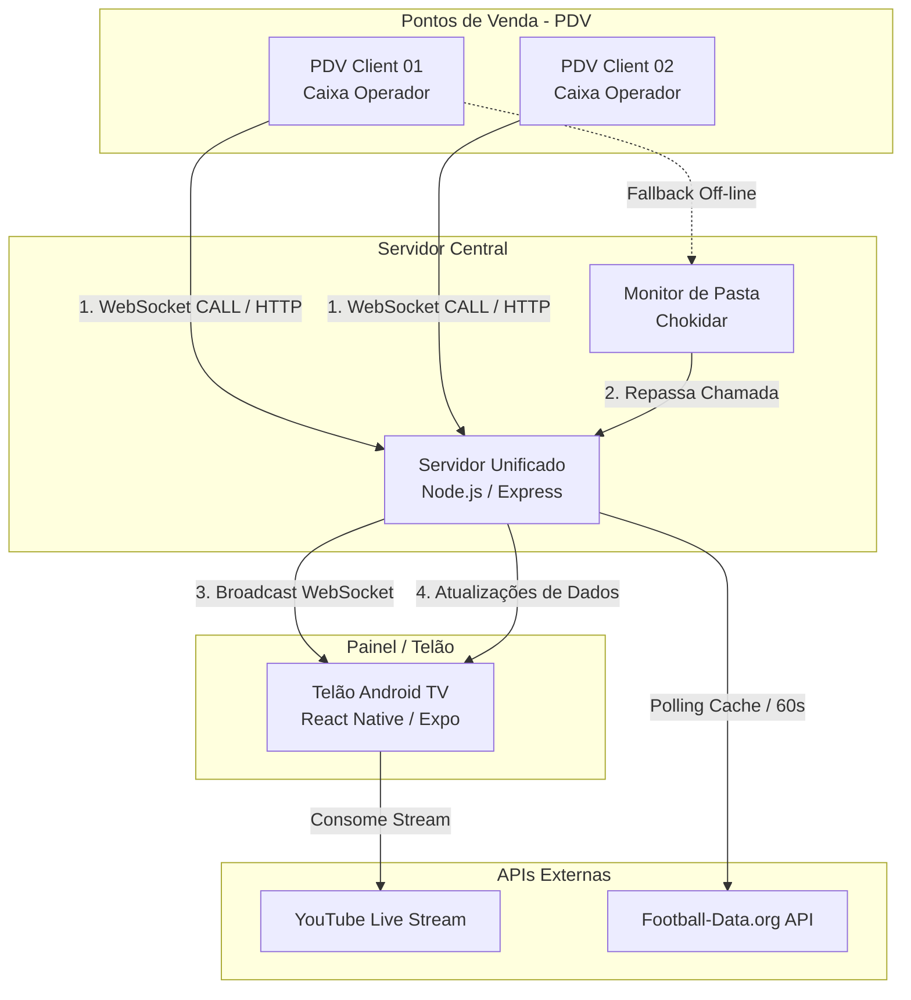

# Chamador de Caixa PRO v2.0 🚀

O **Chamador de Caixa PRO** é uma solução SaaS corporativa robusta e de alta performance desenvolvida para ambientes de varejo e atendimento ao cliente. O sistema foi projetado para gerenciar filas e chamadas de caixas em tempo real, integrando painéis de exibição de mídia digital (*digital signage*), transmissões ao vivo do YouTube, painéis esportivos dinâmicos (Copa do Mundo e campeonatos) e um forte mecanismo de resiliência e contingência local.

---

## 📌 Visão Geral do Fluxo e Arquitetura

O sistema é composto por uma arquitetura multimodular onde cada componente desempenha um papel específico:



---

## 🛠️ Tecnologias Utilizadas por Módulo

### 1. Servidor Unificado (`/server`)
* **Core**: Node.js, Express.
* **Comunicação em Tempo Real**: `ws` (WebSockets) para comunicação bidirecional de baixíssima latência.
* **Persistência**: Arquivos JSON para configurações (`copa_mundo.json`, `esportes.json`, `midias.json`, `streams.json`).
* **Resiliência Local**: `chokidar` monitorando arquivos de chamadas na pasta de contingência de rede.
* **Segurança**: Autenticação básica (*Basic Auth*) para a área administrativa de mídias e painéis.

### 2. Cliente PDV (`/pdv-client`)
* **Estrutura**: Electron (Desktop).
* **Entrada Global**: `uiohook-napi` para registrar o atalho global de teclado (por padrão, `Ctrl + Shift + C` para chamar o caixa).
* **Integração**: Cliente WebSocket para envio de eventos ao servidor e lógica de escrita em disco para fallback off-line.

### 3. Telão Android TV (`/telao-apk`)
* **Framework**: Expo (SDK 56.0.0) / React Native.
* **Exibição Web & TV**: Suporte a compilação nativa para Android TV (`.apk`) e modo web (`react-native-web`) para visualização de homologação.
* **Reprodutor de Mídia**: `expo-av` para mídias locais (vídeos e imagens em loop) e `react-native-youtube-iframe` para transmissões ao vivo resilientes do YouTube.

### 4. Instalador e Serviços (`/installer`)
* **Automação**: Scripts em PowerShell para implantação automática.
* **Gerenciador de Serviços**: **NSSM (Non-Sucking Service Manager)** para registrar e monitorar o servidor Node.js como serviço do Windows, garantindo reinicialização automática e execução silenciosa.

---

## 📁 Estrutura do Repositório

```text
CHAMADOR DE CAIXA PRO/
├── server/                     # Servidor backend Node.js & Painel Admin
│   ├── data/                   # Arquivos de dados JSON e uploads locais
│   ├── public/                 # Painel Administrativo Web (HTML/JS vanilla)
│   ├── routes/                 # Rotas da API REST
│   ├── services/               # Regras de negócios e integrações (Esportes, WS)
│   └── index.js                # Arquivo de entrada principal do servidor
├── pdv-client/                 # Cliente Electron para os caixas de atendimento
│   ├── main.js                 # Processo principal do Electron
│   └── config.json             # Configurações do IP do servidor e número do caixa
├── telao-apk/                  # Código-fonte do Painel Exibidor (Android TV / Expo)
│   ├── src/                    # Componentes React Native (Copa, MediaManager, etc.)
│   ├── App.tsx                 # Ponto de entrada do aplicativo
│   └── app.json                # Configuração do Expo / EAS Build
├── installer/                  # Scripts PowerShell e NSSM para implantação
└── GO_LIVE.md                  # Procedimento para colocação em produção
```

---

## ⚡ Lógica de Negócio e Regras de Ouro

### 🚨 1. Prioridade Absoluta da Chamada
As chamadas de caixa sempre têm prioridade máxima. Mesmo que o telão esteja reproduzindo mídias locais, slides institucionais ou uma transmissão do YouTube Live no momento exato:
1. O stream/vídeo é silenciado e pausado (se aplicável).
2. O **Overlay de Chamada** cobre 100% da tela com um visual de alto contraste (Verde Neon).
3. A voz sintetizada anuncia sonoramente a chamada (ex: *"Senha 01, Caixa 01"*).
4. Após o tempo de exibição, a mídia de fundo é retomada exatamente do ponto em que parou.

### 📁 2. Contingência e Fallback Off-line
Se o servidor cair ou a conexão de rede oscilar, o sistema ativa o mecanismo de fallback estruturado:
1. O **PDV Client** detecta a perda de conexão com o WebSocket.
2. Ao efetuar uma chamada (`Ctrl + Shift + C`), ele cria um arquivo JSON contendo os dados da chamada no diretório compartilhado configurado (ex: `C:\chamador_fallback`).
3. O servidor monitora essa pasta de forma constante usando o **Chokidar**.
4. Assim que a rede/servidor restabelece, os arquivos acumulados na pasta são lidos e processados em ordem cronológica, sendo apagados do disco imediatamente após a emissão do sinal ao telão.

### ⚽ 3. Módulos Esportivos e Copa do Mundo
O telão integra um painel de estatísticas esportivas opcional para engajar clientes:
* **Consumo de API Seguro**: O consumo da API `football-data.org` é feito exclusivamente pelo backend Node.js usando o token `FOOTBALL_DATA_TOKEN` persistido em variáveis de ambiente `.env` (nunca exposto ao frontend).
* **Rate-Limit & Cache**: Devido ao limite de requisições da API gratuita (10 req/min), os dados de jogos e classificação são armazenados em cache local no servidor (`server/data/esportes.json` e `copa_mundo.json`) atualizados de forma assíncrona.
* **Fallback de Mídia**: Se a transmissão do YouTube falhar ou for desativada, o sistema pode exibir o Painel de Competição no telão como conteúdo padrão alternado com as mídias locais.
* **Auto-Rotação sem Rolagem**: A visualização na TV exibe a classificação e rodadas fazendo transições de blocos a cada 15 segundos para eliminar barras de rolagem e garantir legibilidade perfeita a longas distâncias.

---

## 🚀 Como Iniciar em Modo de Desenvolvimento

Certifique-se de ter o [Node.js](https://nodejs.org/) instalado na sua máquina.

### Passo 1: Executar o Servidor Backend
```bash
cd server
npm install
npm run dev
```
* O painel administrativo estará acessível em: `http://localhost:3001/admin`
  * **Usuário Padrão**: `admin`
  * **Senha Padrão**: `123456`
* Os dados do status da API podem ser validados em: `http://localhost:3001/api/status`

### Passo 2: Executar o Cliente PDV (Caixas)
```bash
cd pdv-client
npm install
npm start
```
* O atalho `Ctrl + Shift + C` estará monitorando o teclado globalmente para simular chamadas.

### Passo 3: Executar o Telão de Exibição
Você pode testar o telão diretamente no navegador web:
```bash
cd telao-apk
npm install
npm run web
```
* O telão abrirá no navegador. Na primeira abertura, informe o IP do seu servidor (`127.0.0.1` para testes locais e porta `3001`) e clique em confirmar.

---

## 📦 Implantação e Geração de Build para Produção

### 🖥️ 1. Servidor como Serviço Windows (Produção)
Para instalar o servidor de modo que ele inicialize automaticamente junto com o sistema operacional Windows (sem abrir janelas de terminal):

1. Abra o **PowerShell** como **Administrador**.
2. Navegue até a pasta do projeto e depois até `installer`.
3. Execute o script de instalação automática:
   ```powershell
   Set-ExecutionPolicy Bypass -Scope Process -Force
   .\install.ps1
   ```
4. O script instalará as dependências, baixará e configurará o **NSSM**, criará o serviço Windows `ChamadorCaixaPro` e abrirá a porta `3001` no Firewall do Windows.
5. Comandos úteis de serviço:
   * Verificar status: `Get-Service ChamadorCaixaPro`
   * Iniciar: `Start-Service ChamadorCaixaPro`
   * Parar: `Stop-Service ChamadorCaixaPro`
   * Reiniciar: `Restart-Service ChamadorCaixaPro`

### 📺 2. Compilar APK para a Android TV
O build do aplicativo Android TV é otimizado usando **Expo EAS**:

1. Navegue até a pasta `telao-apk`:
   ```bash
   cd telao-apk
   ```
2. Realize o build remoto gerando um instalador `.apk`:
   ```bash
   npx eas-cli build -p android --profile preview
   ```
3. O terminal fornecerá o link direto para download do `.apk` pronto para instalação na Android TV.
4. Transfira o arquivo para a sua Smart TV (via pendrive ou via aplicativo "Send Files to TV") e instale-o ativando a permissão para fontes desconhecidas nas configurações do Android TV.

### 💻 3. Compilar Executável do PDV Client (Electron)
Para compilar o cliente dos caixas como instalador nativo do Windows:
```bash
cd pdv-client
npm run build
```
* Os instaladores compilados serão gerados na pasta `pdv-client/dist/`.

---

## 🏥 Validação e Diagnóstico do Sistema

Consulte os guias de suporte adicionais detalhados presentes na raiz do repositório:
* 📝 **[Guia Completo de Testes e Implantação](TESTES_E_IMPLANTACAO.md)**: Contém diagramas e checklists detalhados para cada fluxo (mídias locais, YouTube, Copa do Mundo, fallback).
* 🚀 **[Guia de Go-Live e Checklist Final](GO_LIVE.md)**: Protocolo detalhado para ativação final e checklists de pré-requisitos para ambiente de produção.
* 📊 **[Relatório de Mídia e Copa do Mundo](RELATORIO_MODULO_COPA_MUNDO.md)**: Explicação aprofundada dos serviços de integração e fontes de dados da Copa.
* 🎨 **[Relatório de Conformidade de Bandeiras](RELATORIO_BANDEIRAS.md)**: Auditoria e cobertura de carregamento de bandeiras oficiais de países e federações.
