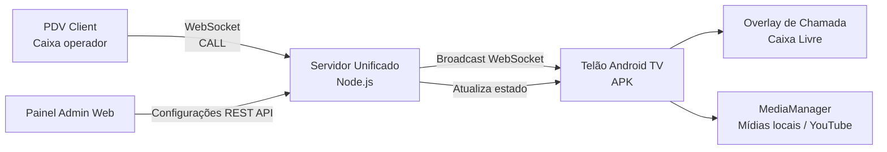
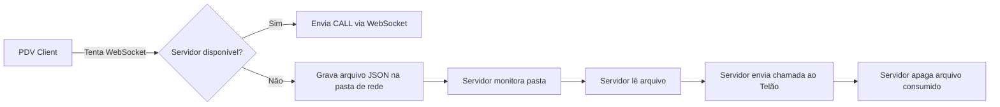
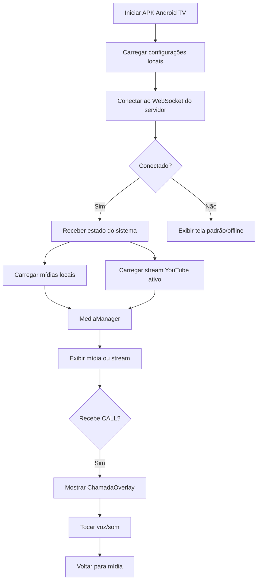
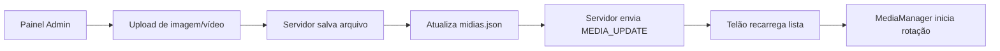
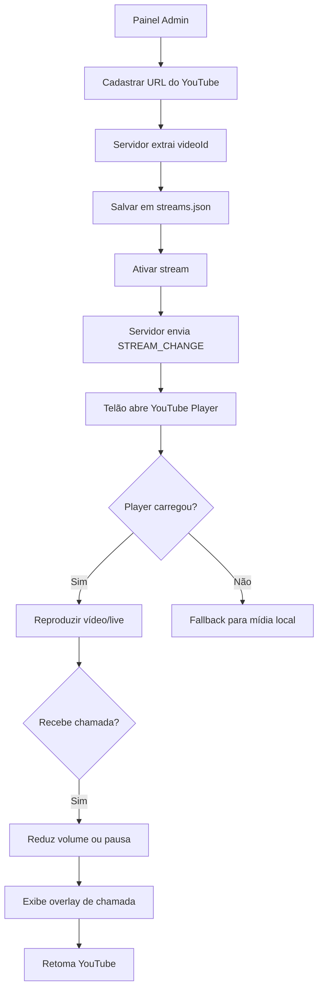
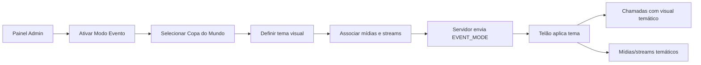
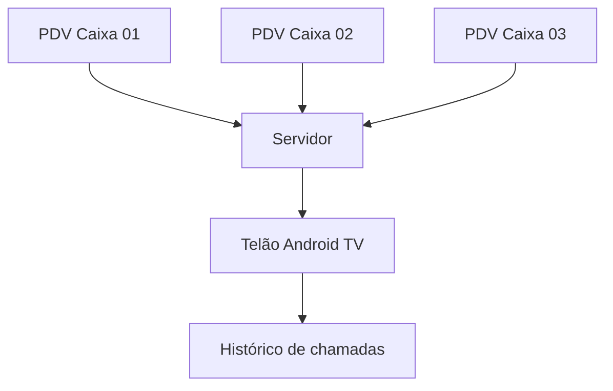
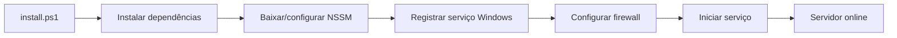

# Checklist Visual — Testes e Implantação
# Chamador de Caixa Pro

Este documento serve como guia de validação do sistema **Chamador de Caixa Pro**, incluindo Servidor Unificado, Cliente PDV, Telão Android TV, Painel Administrativo, YouTube Live, mídias locais, fallback e Modo Evento.

---

## 1. Visão Geral do Fluxo Principal



### Resultado esperado

* O operador pressiona o atalho no PDV.
* O PDV envia a chamada ao servidor.
* O servidor transmite a chamada para o Telão Android TV.
* O Telão exibe o overlay da chamada com som/voz.
* A mídia em execução continua, pausa ou reduz volume conforme configuração.

---

## 2. Fluxo de Contingência por Pasta de Rede



### Checklist

* [ ] Desconectar o servidor temporariamente.
* [ ] Pressionar `Ctrl+Shift+C` no PDV.
* [ ] Confirmar se um arquivo de chamada foi criado na pasta de fallback.
* [ ] Religar o servidor.
* [ ] Confirmar se o servidor leu o arquivo.
* [ ] Confirmar se a chamada apareceu no Telão.
* [ ] Confirmar se o arquivo foi apagado após o consumo.
* [ ] Confirmar se o log registrou o evento.

---

## 3. Fluxo do Telão Android TV



### Checklist

* [ ] Instalar ou iniciar o APK do Telão.
* [ ] Configurar IP do servidor.
* [ ] Confirmar conexão WebSocket.
* [ ] Verificar indicador visual de conectado/desconectado.
* [ ] Testar recebimento de chamada.
* [ ] Verificar overlay de chamada (Overlay fullscreen de chamada no estilo verde neon, com número gigante e instrução “DIRIJA-SE AO CAIXA”).
* [ ] Verificar som ou voz sintetizada.
* [ ] Verificar histórico das últimas chamadas.
* [ ] Verificar se o Telão não fica em tela preta quando não há mídia.

---

## 4. Fluxo de Mídias Locais



### Checklist

* [ ] Acessar `http://localhost:3001/admin`.
* [ ] Fazer upload de imagem.
* [ ] Fazer upload de vídeo.
* [ ] Confirmar se os arquivos aparecem na lista de mídias.
* [ ] Ativar/desativar mídia.
* [ ] Confirmar se o Telão atualiza automaticamente.
* [ ] Confirmar se imagem respeita tempo de exibição.
* [ ] Confirmar se vídeo toca até o final.
* [ ] Confirmar se a rotação volta para o início após terminar.
* [ ] Testar arquivo inválido e verificar se o sistema ignora sem travar.

---

## 5. Fluxo YouTube / Live Stream



### Checklist

* [ ] Cadastrar URL `https://www.youtube.com/watch?v=...`.
* [ ] Cadastrar URL `https://youtu.be/...`.
* [ ] Cadastrar URL `https://www.youtube.com/live/...`.
* [ ] Confirmar se o sistema extrai corretamente o `videoId`.
* [ ] Adicionar 2 ou mais streams no Painel Admin.
* [ ] Ativar o primeiro stream: confirmar que o Telão abre imediatamente o vídeo e que **não há rotação automática** (ele fica fixo).
* [ ] Ativar o segundo stream pelo Painel Admin: confirmar que o primeiro stream é desativado e o Telão muda imediatamente para o segundo.
* [ ] Desativar o stream ativo pelo Admin: confirmar que o Telão retorna para exibição das mídias locais (ou fallback se vazias).
* [ ] Confirmar a persistência do stream:
  - Verificar que o stream ativo no Telão nunca é interrompido para exibir mídias locais por timeouts ou erros de carregamento, mantendo-se sempre fixado na transmissão ativa até ser desativado de forma explícita pelo Admin.
  - Registrar: `Stream ativo permanece no Telão até interrupção manual pelo Admin. Chamadas pausam/mutam temporariamente o stream, mas não encerram a reprodução ativa.`
* [ ] Testar chamada durante a reprodução de um stream:
  - O stream deve ser pausado e silenciado imediatamente (`chamadaAtiva` === true).
  - O overlay de chamada deve cobrir toda a tela.
  - Após finalizar a chamada, a reprodução do stream deve ser retomada automaticamente.
* [ ] Testar controle de som da mídia (`somMidia`):
  - Com `somMidia` desativado no Admin, verificar que mídias e streams rodam 100% mudos (mesmo com som liberado no Telão).
  - Com `somMidia` ativado e `somAtivado` ativado, verificar que o áudio dos vídeos e YouTube toca normalmente.
  - Confirmar que o áudio das mídias nunca se sobrepõe ao áudio das chamadas de caixa (voz/sino).


---

## 6. Fluxo Modo Evento / Copa do Mundo



### Checklist

* [ ] Ativar Modo Evento pelo painel.
* [ ] Selecionar tema Copa do Mundo.
* [ ] Confirmar mudança visual no Telão.
* [ ] Confirmar cores temáticas.
* [ ] Confirmar frases promocionais.
* [ ] Confirmar que chamadas continuam legíveis.
* [ ] Testar chamada durante stream da Copa.
* [ ] Desativar Modo Evento.
* [ ] Confirmar retorno ao tema padrão.

---

## 7. Teste Multi-PDV



### Checklist

* [ ] Abrir dois ou mais PDV Clients.
* [ ] Configurar cada um com número diferente.
* [ ] Disparar chamadas em sequência.
* [ ] Disparar chamadas quase simultâneas.
* [ ] Confirmar que todas chegam ao servidor.
* [ ] Confirmar que o Telão exibe uma por vez sem travar.
* [ ] Confirmar que o histórico mostra a ordem correta.
* [ ] Confirmar que o cooldown evita chamadas duplicadas.

---

## 8. Teste de Serviço Windows



### Checklist

* [ ] Executar PowerShell como Administrador.
* [ ] Rodar `installer/install.ps1`.
* [ ] Confirmar instalação das dependências.
* [ ] Confirmar criação do serviço.
* [ ] Confirmar regra de firewall.
* [ ] Rodar:

```powershell
Get-Service ChamadorCaixaPro
```

* [ ] Confirmar status `Running`.
* [ ] Acessar painel admin pelo navegador.
* [ ] Reiniciar o Windows.
* [ ] Confirmar que o serviço inicia automaticamente.

---

## 9. Testes de API

### Endpoints principais

```http
GET  /api/status
GET  /api/config
GET  /api/midias
POST /api/midias/upload
PUT  /api/midias/:id
DELETE /api/midias/:id
POST /api/midias/reordenar
POST /api/midias/:id/reproduzir-primeiro
POST /api/midias/:id/testar
GET  /api/streams
POST /api/streams
POST /api/streams/:id/ativar
DELETE /api/streams/:id
GET  /api/eventos
POST /api/eventos/:id/ativar
POST /api/chamar
```

### Checklist

* [x] `GET /api/status` retorna servidor online.
* [x] `GET /api/midias` retorna lista normalizada de mídias.
* [x] Upload de mídia funciona.
* [x] Cadastro de stream funciona.
* [x] Ativação de stream envia evento ao Telão.
* [x] Ativação de evento sazonal envia evento ao Telão.
* [x] `POST /api/chamar` dispara chamada manual com validação de parâmetros (1 a 99).
* [x] `POST /api/midias/:id/testar` força a reprodução imediata de teste no Telão.
* [x] Erros retornam JSON claro, sem quebrar o servidor.

---

## 10. Matriz de Testes Essenciais

| Área         | Teste                     | Resultado Esperado      | Status |
| ------------ | ------------------------- | ----------------------- | ------ |
| Servidor     | `npm start` em `server/`  | API e WebSocket online  | [x]    |
| Painel Admin | Abrir `/admin`            | Interface carrega com design moderno, faixa de status real e responsiva | [x]    |
| PDV          | Pressionar `Ctrl+Shift+C` | Chamada enviada         | [x]    |
| WebSocket    | PDV para servidor         | Evento `CALL` recebido  | [x]    |
| Telão        | Tela de Inicialização     | Onboarding libera autoplay e som | [x]    |
| Telão        | Responsividade Mídia      | Vídeos e Streams ocupam 100% da área central (cover) | [x]    |
| Telão        | Autoplay YouTube          | Autoplay inicia automaticamente (muted se somMidia/somAtivado = false) | [x]    |
| Telão        | Streams Manual            | Sem rotação automática; somente o stream ativo manual é exibido | [x]    |
| Telão        | Fallback Banner           | Banner institucional é exibido se não houver mídia ou streams válidos | [x]    |
| Telão        | Receber chamada           | Overlay fullscreen de chamada cobre a tela e silencia/pausa a mídia | [x]    |
| Som          | Chamada de voz            | Áudio toca corretamente | [x]    |
| Fallback     | Servidor fora             | Arquivo é criado        | [x]    |
| Fallback     | Servidor volta            | Arquivo é consumido     | [x]    |
| Mídia local  | Upload de imagem          | Imagem aparece no Telão e rotaciona | [x]    |
| Mídia local  | Upload de vídeo           | Vídeo reproduz e rotaciona | [x]    |
| YouTube      | Ativar stream             | Player do YouTube carrega manualmente o stream ativo | [x]    |
| YouTube      | Persistência do Stream    | O stream ativo permanece fixo e ininterrupto no ar até ser desativado pelo Admin | [x]    |
| YouTube      | Chamada durante stream    | Overlay tem prioridade, pausando/mutando o stream | [x]    |
| Evento       | Ativar Copa               | Tema muda               | [x]    |
| Multi-PDV    | 3 caixas chamando         | Histórico correto       | [x]    |
| Serviço      | Reiniciar Windows         | Servidor inicia sozinho | [x]    |

---

## 11. Comandos Úteis

### Servidor

```powershell
cd "server"
npm start
```

### Cliente PDV

```powershell
cd "pdv-client"
npm start
```

### Telão Android TV

```powershell
cd "telao-apk"
npm run web
```

ou:

```powershell
cd "telao-apk"
npm run android
```

### Serviço Windows

```powershell
Get-Service ChamadorCaixaPro
Start-Service ChamadorCaixaPro
Stop-Service ChamadorCaixaPro
Restart-Service ChamadorCaixaPro
```

---

## 12. Critérios para considerar pronto para produção

O sistema pode ser considerado pronto para implantação piloto quando:

* [ ] Servidor roda como serviço Windows.
* [ ] Painel Admin abre em outro computador da rede.
* [ ] Pelo menos 2 PDVs chamam corretamente.
* [ ] Telão Android TV recebe chamadas em tempo real.
* [ ] Fallback por arquivo funciona.
* [ ] Mídias locais funcionam sem internet.
* [ ] YouTube funciona quando há internet.
* [ ] Sistema não trava quando YouTube falha.
* [ ] Modo Copa ativa e desativa corretamente.
* [ ] Logs registram chamadas, erros e eventos.
* [ ] Após reiniciar o servidor, tudo volta automaticamente.

---

## 13. Regra de Ouro do Sistema

As chamadas de caixa sempre têm prioridade máxima.

Mesmo que o Telão esteja exibindo:

* vídeo local;
* imagem promocional;
* live do YouTube;
* Modo Copa do Mundo;
* tela institucional;

o evento `CALL` deve aparecer imediatamente, com áudio/voz, animação e registro no histórico.

---

## 14. Próxima melhoria recomendada

Depois que os testes acima estiverem funcionando, recomendo implementar:

1. Tela de configuração inicial no APK Android TV para informar IP do servidor.
2. Logs visíveis no Painel Admin.
3. Exportação de relatório de chamadas.
4. Botão de teste no Painel Admin para simular chamada.
5. Geração de APK final para instalação direta na Android TV.
6. Instalador final com Inno Setup.
7. Migração futura de JSON para SQLite.
